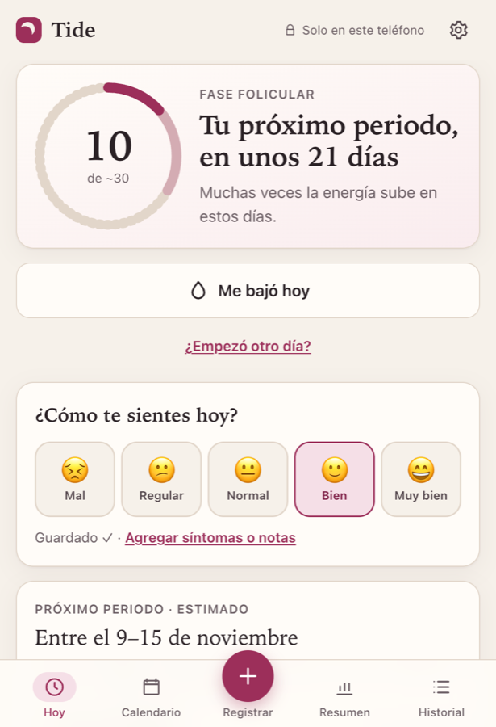
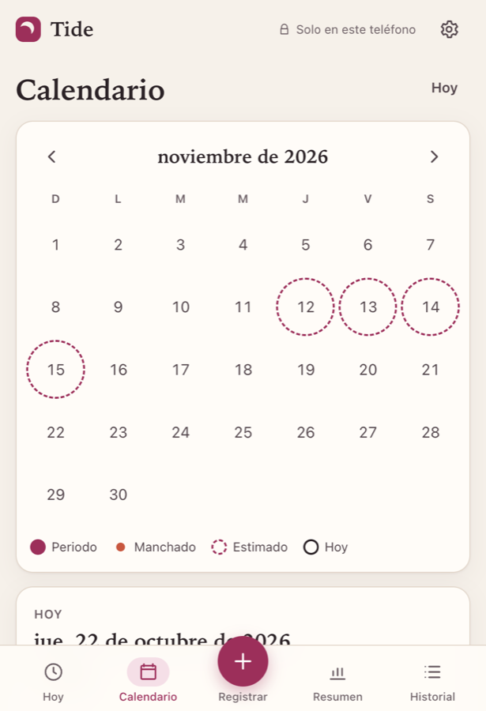
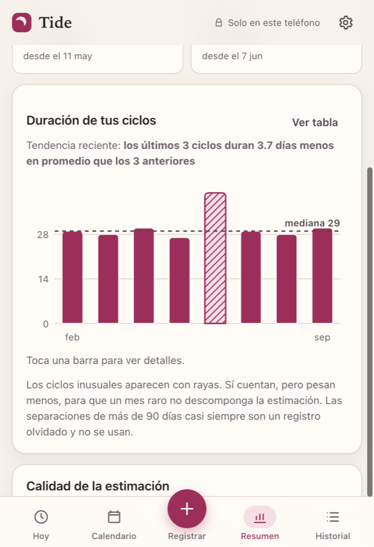
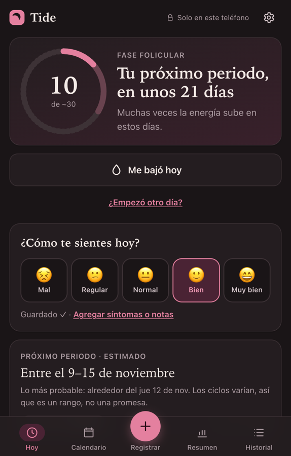

# Tide

[](https://github.com/eduardoge13/tide-cycle-tracker/actions/workflows/ci.yml)
[](LICENSE)

A menstrual cycle tracker that keeps your data on your phone. It has no account, no server, no analytics and no third-party scripts. It's an installable PWA that works offline.

## Get it on your phone (no server needed)

Tide is just static files. Whoever hosts them only hands over the app once; after the first visit it runs from your phone, offline, and the browser blocks it from sending data anywhere.

**Your own copy in about two minutes, free:**

1. **Fork** this repo on GitHub.
2. In your fork: **Settings → Pages → Source: GitHub Actions**.
3. **Actions → Deploy to GitHub Pages → Run workflow.**
4. Open `https://<your-user>.github.io/tide-cycle-tracker/` in **Safari** → **Share → Add to Home Screen**.

Your copy is served by GitHub from your own account. Nobody else, including me, is involved in where it comes from.

<p>
  
  
  
  
</p>

> The interface is in Spanish (es-MX). An English locale is a welcome contribution, see [CONTRIBUTING](CONTRIBUTING.md).

## Why

Most period apps sync health data to a company's cloud. I built Tide for someone close to me who just wanted to know when her next period was coming, without handing that information to anyone. So the design rule was simple: **the data stays on the device unless the user sends it somewhere herself.**

Daily use is meant to take one tap:

- **"Me bajó hoy"** logs a period starting today, with a 7-second undo.
- **"¿Cómo te sientes hoy?"** offers five faces; one tap saves the day. Symptoms, pain, mood, energy, sleep and notes are optional.
- **"¿Ya terminó?"**: after a few days the app asks whether the period ended, so nobody has to remember to log it.
- **Ovulation and fertile days** are marked on the calendar (estimated, can be turned off).
- **"Enviar por correo"** opens the iOS share sheet with a readable summary and a JSON backup. It's the only way data leaves the phone, and it only happens when the user taps it.

## What's interesting under the hood

### 1. A prediction engine that admits uncertainty
[`src/lib/prediction.ts`](src/lib/prediction.ts) is pure TypeScript. It takes `today` as a parameter, so it's deterministic and easy to test.

- **2–5 cycles:** median of cycle lengths. **6+ cycles:** recency-weighted mean of the last six (weights 1…6).
- **Outliers are damped, not deleted.** Lengths outside median ± 3·MAD (minimum ±4 days) are winsorized before averaging. One 41-day cycle barely moves the estimate, but it stays visible (hatched) in the chart.
- **Always a range, never a date.** The width comes from the standard deviation of recent cycles.
- **It learns from its misses.** When a new period is logged, the app stores how far off the previous estimate was. If recent estimates kept missing, the range widens and confidence drops.
- Implausible gaps (<15 or >90 days) are kept and shown but excluded from the estimate. Usually they mean a missed log.

### Ovulation, counted backwards
[`src/lib/ovulation.ts`](src/lib/ovulation.ts) estimates ovulation as *predicted next period − luteal phase − 1*. The luteal phase is much steadier than the first half of the cycle, so counting back is more accurate than counting forward from the last period. When the user logs positive ovulation (LH) tests, the app learns her own luteal length (median of the last six cycles). Without them it uses the 14-day average and caps confidence at "medium". The range combines the period range and the luteal spread. It's labelled everywhere as educational and **not** contraception.

### 2. Dates without timezone bugs
Every date is a `YYYY-MM-DD` string converted to a UTC day number for arithmetic ([`src/lib/dates.ts`](src/lib/dates.ts)). Logging at 11:30 pm, travelling, or crossing a DST change never shifts a period by a day. The tests cover the US and EU DST boundaries.

### 3. Offline-first with a hand-written service worker
A small Vite plugin ([`vite.config.ts`](vite.config.ts)) emits `sw.js` at build time with the exact list of hashed assets to precache, versioned by content hash.

One bug worth mentioning: offline loads were failing even though the cache was full. Vite adds `crossorigin` to its script and style tags, and the server replied with `Vary: Origin`, so `caches.match` never matched. The fix is `ignoreVary: true` on our own same-origin assets ([`src/sw-template.js`](src/sw-template.js)).

### 4. Privacy enforced by the browser, not by promises
- The production build injects a CSP of `default-src 'self'` and `connect-src 'self'`. Even a compromised dependency couldn't send data out. The CSP is skipped in dev so hot reload keeps working.
- Nothing is ever logged to the console.
- The example nginx config turns access logs off.

### 5. Data that survives app updates
There is one versioned `localStorage` key, with step-by-step `MIGRATIONS`. Data written by a newer version is refused instead of corrupted. Imports go through the same migrate-then-validate path, with readable errors and a size cap ([`src/lib/storage.ts`](src/lib/storage.ts)).

### 6. Accessible on a phone
- Bottom navigation within thumb reach and 44 px+ touch targets.
- Text follows iOS Dynamic Type, and inputs stay at 16 px+ so iOS doesn't zoom.
- Light and dark themes, plus `prefers-reduced-motion` and forced-colors support.
- ARIA roles on the calendar and chart, and a table view as an alternative to the chart.

## Stack

React 18 · TypeScript (strict, `noUncheckedIndexedAccess`) · Vite 5 · Vitest · plain CSS with design tokens. The only runtime dependencies are `react` and `react-dom`.

## Run it

```bash
npm ci
npm run dev          # http://localhost:5173
npm test             # 58 unit tests
npm run typecheck
npm run build        # dist/ with sw.js and the production CSP
npm run preview -- --host   # open on your phone over the LAN
```

To try it with fictional data: **Ajustes → Cargar datos de ejemplo**.

## Self-hosting

`dist/` is plain static files with relative paths, so any static host works: GitHub Pages, Netlify, an S3 bucket, or nginx. You need HTTPS for the service worker and for "Add to Home Screen".

[`deploy/`](deploy) has the recipe I use: nginx (read-only container, no access logs) behind an existing Traefik proxy.

```bash
cp deploy/.env.example deploy/.env   # your SSH host, domain, Traefik network
./deploy/deploy.sh                   # tests → build → one SSH upload → atomic swap → curl check
```

## Project layout

```
src/lib/        prediction, dates, storage + migrations, validation, stats, calendar marks, share
src/screens/    Hoy, Calendario, Registrar, Historial, Resumen, Ajustes
src/components/ forms, chart (SVG, no chart library), cycle ring, UI primitives
tests/          Vitest unit tests for everything in src/lib
deploy/         optional nginx + Traefik self-hosting recipe
```

## Limits, honestly

- It's a calendar estimate, not medical advice. The optional fertile-window view says so wherever it appears, and it is **not** contraception.
- If you clear Safari's website data or delete the home-screen app without a backup, the data is gone. That's the trade-off of having no server.
- There is no app-level PIN yet.

## License

[MIT](LICENSE) © Eduardo Gaitán
